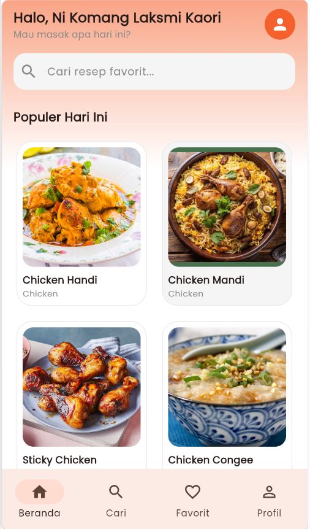
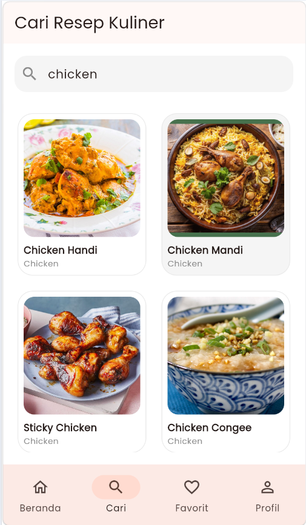
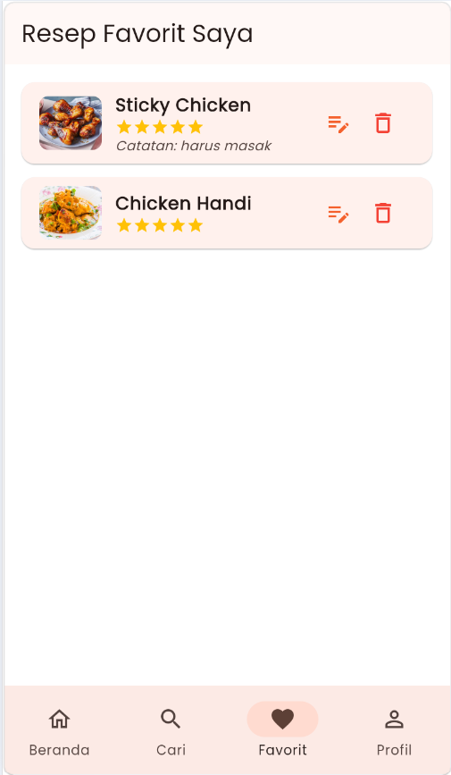
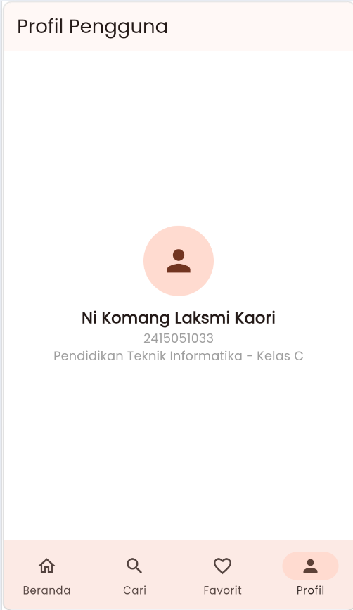

# ResepKU - Aplikasi Resep Kuliner & Manajemen Favorit

Aplikasi **ResepKU** adalah platform mobile & web berbasis Flutter yang dirancang untuk membantu pengguna menjelajahi berbagai resep kuliner global, melihat bahan dan langkah memasak dalam Bahasa Indonesia, serta menyimpan resep favorit dengan catatan pribadi dan rating ke database Supabase.

Proyek ini disusun untuk memenuhi **Ujian Tengah Semester (UTS)** mata kuliah Pemrograman Berbasis Mobile.

---

## 👩‍🎓 Identitas Mahasiswa

* **Nama**: Ni Komang Laksmi Kaori
* **NIM**: 2415051033
* **Kelas**: PTI 5 C
* **Prodi**: Pendidikan Teknik Informatika 
* **Instansi**: Universitas Pendidikan Ganesha

---

## 🚀 Fitur Utama

1. **Responsif & Adaptif (Multi-platform)**
   * Menyesuaikan tampilan secara dinamis untuk perangkat smartphone (`NavigationBar`) dan laptop/tablet (`NavigationRail`).
2. **Pencarian & Eksplorasi Resep Live**
   * Mengintegrasikan REST API dari [TheMealDB](https://www.themealdb.com/) untuk memuat resep populer dan pencarian kata kunci *real-time*.
3. **Penerjemahan Otomatis & Penomoran Langkah Rapi**
   * Menerjemahkan nama bahan dan instruksi memasak ke Bahasa Indonesia menggunakan integrasi `translator`.
   * Menampilkan langkah-langkah memasak dalam format nomor urut (`1., 2., 3...`) yang terstruktur.
4. **Backend Database CRUD (Supabase)**
   * **Create**: Menyimpan resep ke daftar favorit lengkap dengan rating bintang (1-5), status dimasak, dan catatan pribadi.
   * **Read**: Memuat daftar favorit pribadi langsung dari database cloud Supabase (`saved_recipes`).
   * **Update**: Memperbarui catatan dan rating resep favorit kapan saja.
   * **Delete**: Menghapus resep dari daftar favorit dengan konfirmasi dialog.
5. **State Management & State Handling**
   * Dikelola penuh menggunakan skema `Provider` (`ChangeNotifier`).
   * Penanganan state interaktif: *Loading*, *Success*, *Error*, dan *Empty State*.

---

## 📱 Tampilan Aplikasi

| Beranda | Pencarian | Detail Resep | Catatan Resep | Favorit | Profil |
| :---: | :---: | :---: | :---: | :---: | :---: |
|  |  |  |  |  |  |

---

## 🛠️ Teknologi & Library

* **Framework**: Flutter (Dart SDK)
* **State Management**: `provider`
* **HTTP Client**: `http`
* **Backend Cloud**: Supabase (`supabase_flutter`)
* **Environment Config**: `flutter_dotenv`
* **Translation Engine**: `translator`

---

## 📂 Struktur Folder Proyek

```text
lib/
├── core/              # Tema, warna, konstanta, dan exception handler
├── models/            # Model data (Recipe, RecipeCategory, SavedRecipe)
├── providers/         # State management (RecipeProvider, FavoriteProvider)
├── repositories/      # Layer bisnis/data repository
├── screens/           # Tampilan utama (Home, Search, Detail, FavoriteForm, Favorites, Profile)
├── services/          # Integrasi API (MealApiService, SavedRecipeService)
└── widgets/           # Komponen UI reusable (Card, Grid, State Views)
supabase/
└── schema.sql         # Skema database & RLS policy Supabase
```

---

## ⚙️ Cara Menjalankan Project

### 1. Clone Repositori
```bash
git clone https://github.com/kaorilaksmi-bit/UTS_2415051033_LaksmiKaori.git
cd UTS_2415051033_LaksmiKaori
```

### 2. Install Dependensi
Jalankan perintah berikut untuk mengunduh semua library/package yang digunakan:
```bash
flutter pub get
```

### 3. Konfigurasi Environment (`.env`)
Buat file `.env` di direktori utama (root) proyek dan isi dengan kredensial Supabase Anda:
```env
SUPABASE_URL=https://dxzmoabstldohahkyolc.supabase.co
SUPABASE_ANON_KEY=sb_publishable_33a8Ivxrw6b-LL7DF-8AEQ_KE9WSanF
```

### 4. Jalankan Aplikasi
Jalankan aplikasi di perangkat emulator, atau perangkat fisik:
```bash
flutter run 
```

---

## 📱 Download Application Package (APK)

Aplikasi **ResepKU** dapat langsung diinstal dan diuji pada perangkat Android melalui tautan di bawah ini:

- 📥 **Direct Download APK**: [Download UTS_2415051033_Ni Komang Laksmi Kaori (Release APK)](https://drive.google.com/file/d/1zZNIPokyC7rlVIJtMfP9m0RdoR9AoaJj/view?usp=drive_link)
- 🌐 **Web Version**: Available on `build/web`

### Spesifikasi APK:
- **Nama File**: `UTS_2415051033_Ni Komang Laksmi Kaori.apk`
- **Versi Application**: 1.0.0
- **Target OS**: Android 5.0 (API Level 21) ke atas
- **Ukuran File**: ~52.6 MB